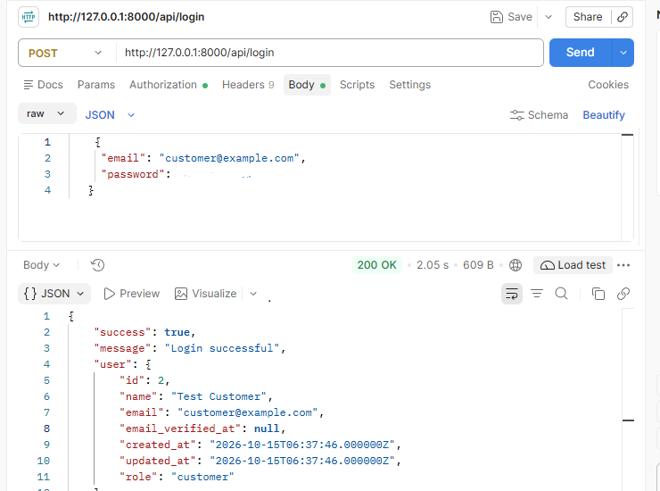
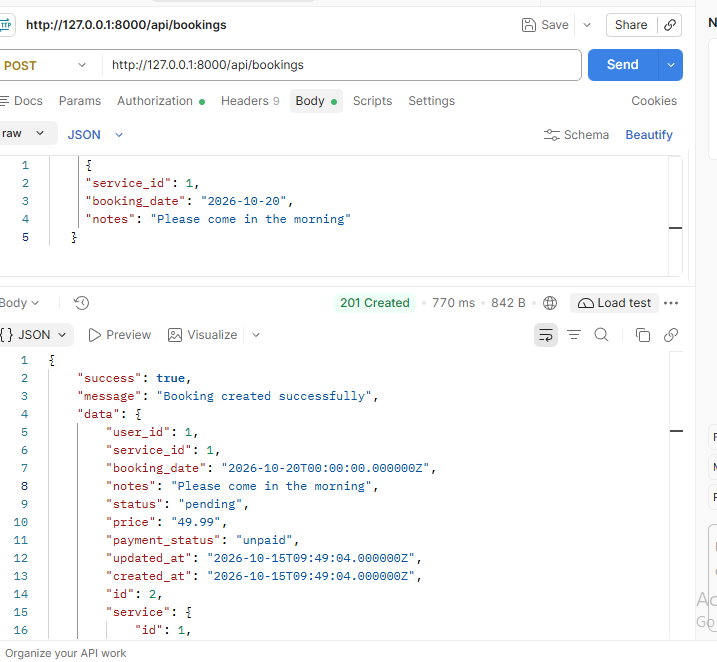
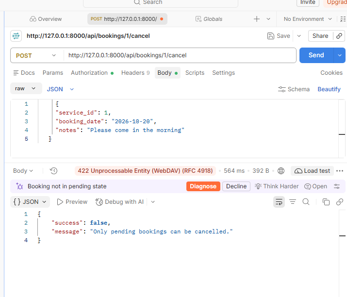

# Service Booking REST API

A RESTful API built with **Laravel 9** and **Laravel Sanctum** for managing services and customer bookings.
It includes token authentication, role-based access (Admin / Customer), and a ready-to-use Postman collection.

## Features

- Token-based authentication with Laravel Sanctum (register, login, logout, profile)
- Role-based access control: **Admin** and **Customer**
- Public service catalog (list and details)
- Admin: create and update services
- Customer: create bookings, view own bookings, cancel pending bookings
- Admin: view all bookings and update booking status
- Request validation and consistent JSON responses (including JSON 401 / 422 errors)
- Database migrations and a seeder with demo users and services
- Postman collection included (`docs/`)

## Tech Stack

| | |
|---|---|
| Framework | Laravel 9 (PHP 8) |
| Authentication | Laravel Sanctum (Bearer tokens) |
| Database | MySQL |
| Testing | Postman |

## Installation

```bash
# 1. Clone the repository
git clone https://github.com/samina2108/service-booking-rest-api.git
cd service-booking-rest-api

# 2. Install dependencies
composer install

# 3. Create the environment file and app key
cp .env.example .env
php artisan key:generate
```

Open `.env` and set your database details:

```env
DB_DATABASE=your_database_name
DB_USERNAME=your_username
DB_PASSWORD=your_password
```

```bash
# 4. Create tables and demo data
php artisan migrate
php artisan db:seed

# 5. Start the server
php artisan serve
```

The API is now available at `http://127.0.0.1:8000/api`.

## Demo Accounts

Created by `php artisan db:seed` (for **local testing only**; do not use these credentials on a live server):

| Role | Email | Password |
|---|---|---|
| Admin | admin@example.com | password123 |
| Customer | customer@example.com | password123 |

The seeder also adds three demo services (Home Cleaning, AC Repair, Plumbing Service).

## Authentication

Log in to receive a token, then send it with every protected request:

```
Authorization: Bearer <your_token>
Accept: application/json
```

Example login request:

```http
POST /api/login
Content-Type: application/json

{
  "email": "customer@example.com",
  "password": "password123"
}
```

## API Endpoints

Base URL: `http://127.0.0.1:8000/api`

### Auth

| Method | Endpoint | Access | Description |
|---|---|---|---|
| GET | `/test` | Public | Check that the API is running |
| POST | `/register` | Public | Register a new customer (returns token) |
| POST | `/login` | Public | Log in (returns token) |
| GET | `/profile` | Authenticated | Get the logged-in user |
| POST | `/logout` | Authenticated | Revoke the current token |

### Services

| Method | Endpoint | Access | Description |
|---|---|---|---|
| GET | `/services` | Public | List services |
| GET | `/services/{id}` | Public | Service details |
| POST | `/services` | Admin | Create a service |
| PUT | `/services/{id}` | Admin | Update a service |

### Bookings

| Method | Endpoint | Access | Description |
|---|---|---|---|
| GET | `/bookings` | Authenticated | Customer: own bookings. Admin: all bookings |
| POST | `/bookings` | Customer | Create a booking |
| GET | `/bookings/{id}` | Authenticated | Booking details |
| POST | `/bookings/{id}/cancel` | Customer | Cancel own pending booking |
| PATCH | `/bookings/{id}/status` | Admin | Update booking status |

Example: create a booking

```http
POST /api/bookings
Authorization: Bearer <token>

{
  "service_id": 1,
  "booking_date": "2026-10-20",
  "notes": "Please come in the morning"
}
```

`booking_date` must be today or a future date.

## Error Responses

All `/api/*` errors are returned as JSON, even without an `Accept` header.

| Code | Meaning |
|---|---|
| 401 | Missing or invalid token |
| 403 | Logged in, but not allowed (for example, a customer calling an admin endpoint) |
| 404 | Resource not found |
| 422 | Validation failed |

## Testing with Postman

1. Import `docs/Service-Booking-API-v2.postman_collection.json` into Postman.
2. Start the server with `php artisan serve`.
3. Run **Login CUSTOMER** and **Login ADMIN**. The tokens are saved automatically.
4. Run the requests in **Services** and **Bookings**.

## Screenshots

### Login


### Create Booking


### Cancel Bookings



## Author

**Samina** | Laravel Developer
GitHub: [samina2108](https://github.com/samina2108)

## License

This project is open-sourced under the [MIT license](https://opensource.org/licenses/MIT).
